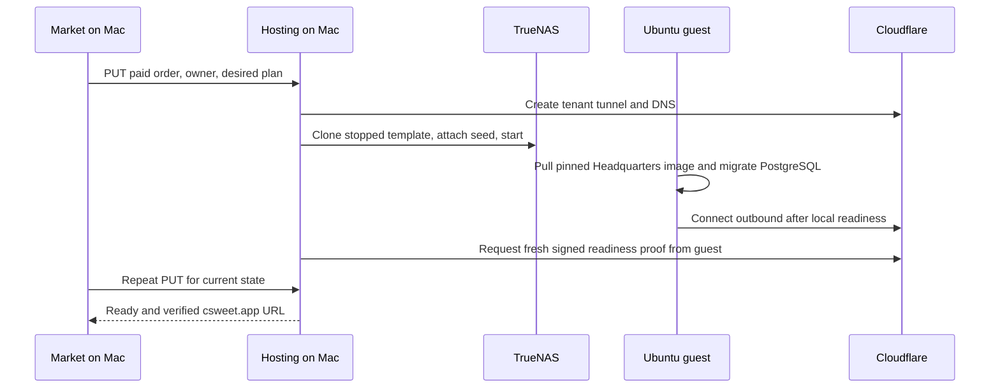

# C-Sweet Hosting

Build, publish and deploy a version with the [Mac Studio release and operator API guide](docs/mac-studio-release.md). The standalone service supports API-only testing from this PC over Tailscale SSH. The Market Compose instructions below also support the original combined development setup.

Market calls this private web service after a signed Stripe test payment. The Mac Studio runs the service beside Market. TrueNAS supplies one Linux VM per purchased Headquarters. The guest makes an outbound Cloudflare connection. My Headquarters displays the unique URL after the service verifies the guest's database and buyer reservation over that URL.



## First visit to the Mac

Naomi can start by opening the existing Market deployment folder on the Mac, running `docker compose ls`, and opening the TrueNAS dashboard at `192.168.1.134` on the local network. Record the Market folder, TrueNAS storage pool name and the guest network interface shown under Virtual Machines. These are read-only checks. Keep passwords and tokens on the Mac.

## Prepare once

1. Put this repository beside the current Market checkout on the Mac. Use the same Compose project and production env file as the running website. Use a version of Market that contains `compose.hosting-lab.yml`. Back up its database before applying Market migrations.
2. On TrueNAS select a dedicated parent dataset for disposable VM disks, plus a private dataset for seed media. Mount only the media share on the Mac. Example names are `tank/csweet-lab/disks`, `/mnt/tank/csweet-lab/media` on TrueNAS and `/Volumes/csweet-media` on the Mac. Substitute the actual pool. The provisioner container (UID 10001) must be able to create and rename files on the mount, and the NAS hypervisor must be able to read those files. Keep the share inaccessible to customers. It holds per-guest credentials.
3. Use a DHCP-enabled VM network with outbound DNS, HTTPS and Cloudflare Tunnel connectivity. For a public test guest choose an isolated network that cannot reach the NAS management interface, the Mac or private home devices. The Mac provisioner needs private network access to TrueNAS. Only the customer web application goes through the tenant tunnel.
4. Under the Market checkout's `secrets/`, save the NAS API key in `hosting-nas-key.txt`, its trusted CA certificate in `hosting-nas-ca.pem`, and the Cloudflare API token in `hosting-cloudflare-token.txt`. Restrict the files to the deployment account, with container read access. Use a TrueNAS service identity allowed to query, clone, start, stop and delete lab VMs and attach VM devices. Template preparation also requires permission to create a zvol. Use a Cloudflare token with Tunnel Write on the hosting account and DNS Edit on the `csweet.app` zone. Check that the zone is active. The existing website tunnel continues serving Market and the Stripe webhook.
5. From the **csweet** GitHub Actions tab run **Linux Headquarters image** on a reviewed revision. The job summary contains the immutable `ghcr.io/...@sha256:...` reference. For the hosted GHCR package, configure the Mac's registry reader as described in [Mac Studio release setup](docs/mac-studio-release.md#private-headquarters-images). Hosting downloads the pinned amd64 image and places it on the guest's private NoCloud ISO. The guest verifies and loads this archive on first boot. Other registries retain their existing guest pull behavior.
6. Extend the Mac's existing private `.env.production` with the following values. Names and paths below are examples. Generate `HOSTING_SERVICE_KEY` locally with `openssl rand -hex 32`. Set `HOSTING_TEST_ACCOUNTS` to comma-separated Market user IDs. Use a Stripe sandbox endpoint for `https://c-sweet.com/api/v1/hosting/stripe/webhook` and the events listed in Market's hosting guide. Use the Market account issuer at `https://account.c-sweet.com/` for purchaser activation.

```dotenv
HOSTING_CHECKOUT=../CSweet.Hosting
HQ_IMAGE=ghcr.io/crosswiredstudios/csweet-headquarters-hosted@sha256:REPLACE_WITH_DIGEST
TRUENAS_URL=wss://nas.example.internal/api/current
TRUENAS_USERNAME=csweet_hosting
HOSTING_TEMPLATE_NAME=csweet_ubuntu_2404_v1
NAS_MEDIA_PATH=/mnt/tank/csweet-lab/media
MAC_MEDIA_PATH=/Volumes/csweet-media
HOSTING_CF_ACCOUNT_ID=REPLACE
HOSTING_CF_ZONE_ID=REPLACE
HOSTING_SERVICE_KEY=REPLACE
HOSTING_STRIPE_TEST_KEY=sk_test_REPLACE
HOSTING_STRIPE_WEBHOOK_SECRET=whsec_REPLACE
HOSTING_TEST_ACCOUNTS=REPLACE_WITH_MARKET_ACCOUNT_ID
```

The NAS URL must resolve on the Mac and in the container and match the NAS certificate. Use the IP address only if the trusted certificate covers it.

7. From Market, define a shell shortcut for this session. Run the read-only NAS check. It prints virtualization support, available guest memory, VM network choices and whether the selected template exists.

```sh
lab() { docker compose --env-file .env.production -f compose.production.yml -f compose.hosting-lab.yml "$@"; }
lab build provisioner
lab run --rm --no-deps provisioner preflight
```

8. Download Canonical's Ubuntu Server 24.04 LTS **amd64 cloud image** and the matching signed SHA256SUMS to a trusted computer. Verify the sums signature with the Canonical cloud-image signing key and verify the image against that manifest. Copy the verified QCOW2 image to the private media share with the basename below. Keep the template never booted so every clone runs first-boot setup with a new identity. [Ubuntu release images](https://cloud-images.ubuntu.com/releases/24.04/release/) · [NoCloud seed format](https://docs.cloud-init.io/en/latest/reference/datasources/nocloud.html)

```sh
lab run --rm --no-deps provisioner prepare-template \
  --image ubuntu-24.04-amd64.qcow2 --sha256 VERIFIED_LOWERCASE_SHA256 \
  --dataset tank/csweet-lab/disks --nic YOUR_VM_INTERFACE
lab run --rm --no-deps provisioner preflight
```

The command creates a sparse 64 GiB zvol and a stopped 6 GiB UEFI guest. Select a smaller guest allocation with `--memory` if measured use permits. If import fails, inspect the conversion job and any newly created zvol. An existing template or disk of the same name stops the command. Validate disk import against the installed NAS release on the first run. [TrueNAS disk conversion API](https://api.truenas.com/v25.10.0/api_methods_vm.device.convert.html) · [TrueNAS cloning API](https://api.truenas.com/v25.10.0/api_methods_vm.clone.html)

## First checkout

In the Market folder run `lab up -d --build web provisioner`, keeping the same project name as the existing deployment. Check `lab ps`. Sign in with the allowed test account, buy the $99 Headquarters plan with a Stripe test card, then open My Headquarters. A paid order moves from **Setting up** to **Ready** after its public HTTPS endpoint returns a fresh proof for the order, owner and image digest. Follow the link and activate with the same Market identity. Verify the other account cannot complete first-run setup. Office purchases and public Office gateway connectivity are outside this initial hardware checkout.

If setup stalls, check the Market payment status, provisioner logs, VM state, then the guest console and `journalctl -u csweet-bootstrap`. Check that Hosting can pull the pinned Headquarters release and that the guest can reach Cloudflare. Redelivery of the same order resumes its original allocation. The guest holds its own database, signing material and tunnel token. No router port forwarding or public management route is required.

## Retire a disposable test deployment

The authenticated private `DELETE /v1/deployments/{orderId}` removes that guest and its private disk, per-order Cloudflare route and seed ISO. This destroys its data. Use the exact disposable test order ID. Repeat until 204 (202 means in progress; 409 means the current operation must finish). The retired order cannot recreate the VM. Handle the Stripe test subscription separately. The stored Market ready link is historical after operator retirement. Retain the provisioner's `hosting-state` volume across deployments. Removing it loses ownership and recovery records. The service supports multiple independent orders; the operator controls lab capacity.

## Provider boundary and tests

`CSweet.Hosting` is an ASP.NET Core service targeting .NET 10. `DeploymentStore` preserves the SQLite order records and `DeploymentWorker` resumes unfinished orders at startup. Each order pins its pool, template, image digest and allocation name. The bearer-authenticated Market purchase and status contract uses `PUT /v1/deployments/{orderId}`. A repeat with a different purchase returns 409.

`IComputeProvider` prepares per-guest bootstrap data, ensures the allocation is running, and removes it. `TrueNasProvider` implements those operations with a NoCloud ISO and the NAS API. Register a new provider in dependency injection keyed by its pool identifier, then select that pool for new orders. Retain the previous registration while its orders are active. `CloudflareIngress` and the buyer-bound readiness probe work independently of the compute provider.

The control-plane image runs the .NET service and uses `genisoimage` to create seed media. The embedded `linux/bootstrap.py` runs inside each Ubuntu guest and generates its local Compose configuration.

```sh
docker build --target test --progress plain .
docker build -t csweet-hosting:lab .
```

These tests exercise authenticated HTTP, restart/retry behavior, clone isolation and the real seed ISO format with simulated infrastructure. First deployment on a specific NAS additionally verifies the NIC, disk conversion, TLS trust, share permissions and tunnel.
